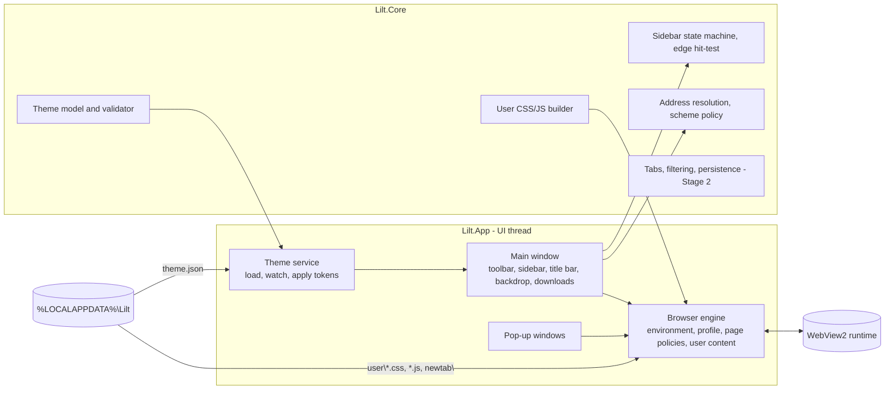
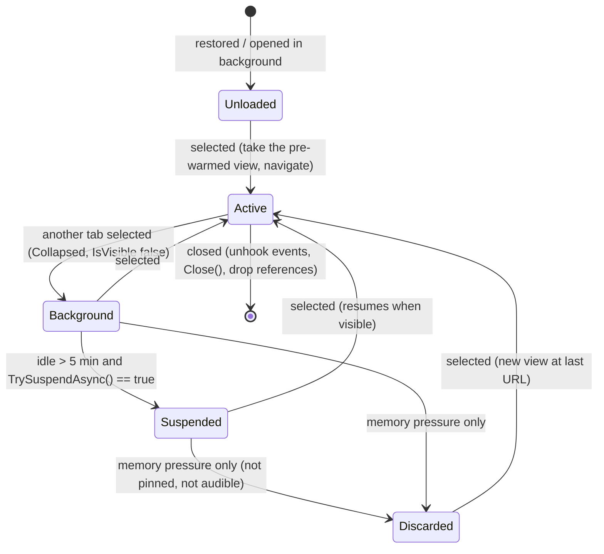

# Lilt architecture (Stage 1)

Status: revised 2026-10-20 for v0.3 (sections 6.5, 6.6, 8.0, 14). Revised 2026-10-19 for v0.2. Built so far: the prototype in section 11, plus tabs, saved sessions, bookmarks and import, the home tab, the glass backdrop and Customize panel, bundled uBlock Origin Lite and Chrome Web Store extensions (section 13).

Lilt is a personal Windows 11 browser built on WebView2. Priorities, in order: customization, performance, content blocking, privacy, import convenience. This document records what the platform allows, what Lilt has to build itself, what is still unproven, and what is not possible.

Feasibility labels:

| Label | Meaning |
|---|---|
| **[API]** | Supported by a documented, stable API. |
| **[Custom]** | Lilt must implement it on top of documented APIs. |
| **[Experimental]** | Plausible but unverified, or relies on undocumented behavior, Chromium flags or the DevTools Protocol. Needs a spike before it is promised. |
| **[Unsupported]** | Not exposed by WebView2, or impractical for this project. |

---

## 1. Stack

| Layer | Choice | Version at time of research |
|---|---|---|
| Language/runtime | C# on .NET 10 (LTS, supported to 2028-11-14) | 10.0.12 (2026-09-08) or newer patch |
| UI framework | WinUI 3 (Windows App SDK) | Windows App SDK 2.5.1 (2026-09-16), via the component package `Microsoft.WindowsAppSDK.WinUI` 2.3.9 |
| Web engine | WebView2, Evergreen runtime | SDK `Microsoft.Web.WebView2` 1.0.4258.31 (2026-09-28) |
| Target | Windows 11 (build 22000+), x64 | |
| Packaging | Unpackaged, self-contained (.NET and Windows App SDK inside the app folder), ReadyToRun | Personal builds; no installer or updater |
| License | GPL-3.0-or-later | |

Version notes:

- Windows App SDK moved to semantic versioning with 2.0 (2026-04-29); the 1.8 line left servicing on 2026-09-24. The `Microsoft.WindowsAppSDK` metapackage also pulls in AI, ML (ONNX Runtime, DirectML), Search and Widgets. Lilt references only the WinUI component, which brings Foundation, InteractiveExperiences and Base, to keep those binaries out of the app folder.
- From runtime 152 (2026-08-24) WebView2 follows Edge's two-week cadence; SDK packages are released as needed. Evergreen apps patch themselves.
- .NET 11 (November 2026) is an STS release; staying on LTS is less maintenance.

Why WebView2 rather than a full engine:

- **Chromium via CEF (CefSharp)** is the only credible alternative on Windows: in-process request filtering on the network thread and full engine control, at the cost of a ~200 MB bundled Chromium, owning a one-to-two-week security patch cadence, and no Widevine out of the box. Not worth it unless the filtering paths in section 5 all fail.
- **Gecko** has no maintained Windows embedding API. Not viable.

## 2. What WebView2 gives Lilt, and what it doesn't

| Capability | Status | Notes |
|---|---|---|
| Rendering, navigation, back/forward, reload | [API] | |
| One shared environment and profile for all views | [API] | One environment and user data folder: one browser process, one GPU process, renderers per site. |
| Named profiles and InPrivate in one environment | [API] | `CoreWebView2ControllerOptions.ProfileName`, `IsInPrivateModeEnabled`. WinUI's `EnsureCoreWebView2Async(environment, options)` accepts them; the prototype uses it, and spike 1 confirms it at runtime. |
| Pop-ups that keep `window.opener` | [API] | `NewWindowRequested` with a deferral, setting `NewWindow` to a new WebView2 in the same profile. Implemented in the prototype. |
| Suspend a hidden tab | [API] | `TrySuspendAsync` needs `IsVisible == false`, is best effort, and fails in cases like audio playback ([docs](https://learn.microsoft.com/en-us/dotnet/api/microsoft.web.webview2.core.corewebview2.trysuspendasync)). |
| Lower memory of an inactive tab that keeps running | [API] | `MemoryUsageTargetLevel = Low`; not to be mixed with suspend ([docs](https://learn.microsoft.com/en-us/dotnet/api/microsoft.web.webview2.core.corewebview2.memoryusagetargetlevel)). |
| Process list for measurements | [API] | `CoreWebView2Environment.GetProcessInfos()`. |
| Tracking prevention level | [API], per profile only | `PreferredTrackingPreventionLevel` applies to the whole profile and is persisted. There is no per-site level. Default: **Balanced**. Strict breaks more sites and can break federated sign-in; a second profile for exceptions would mean separate cookies and logins. |
| Saved passwords and the autofill dropdown | [API], rendering unverified | `IsPasswordAutosaveEnabled` (on in the prototype). Whether saved passwords persist and the dropdown draws correctly under composition hosting is part of spike 1. No API imports passwords into it. |
| Address/card autofill | [API] | `IsGeneralAutofillEnabled`, off in the prototype. |
| SmartScreen | [API] | `IsReputationCheckingRequired`. Kept on: it is the only malicious-site and download protection Lilt has. Users must be told that URLs are checked with Microsoft ([data privacy](https://learn.microsoft.com/microsoft-edge/webview2/concepts/data-privacy)). |
| Crash dumps kept local | [API] | `IsCustomCrashReportingEnabled = true`. |
| WebView2's required diagnostic data | [Unsupported] to disable | Collected regardless of app settings. Lilt itself sends nothing, but can't claim the engine sends nothing. |
| Certificate errors | [API] | `ServerCertificateErrorDetected`; Lilt always cancels and never offers "continue anyway". |
| Downloads with Lilt's own UI | [API] | `DownloadStarting` with `Handled = true`, then `CoreWebView2DownloadOperation`. Implemented in the prototype. |
| Local pages (new-tab page) | [API] | `SetVirtualHostNameToFolderMapping`. `WebResourceRequested` does not fire for these hosts. |
| Page color scheme (dark mode for sites) | [API] | `CoreWebView2Profile.PreferredColorScheme`, driven by the theme. |
| Per-site user CSS and scripts | [API] for injection | `AddScriptToExecuteOnDocumentCreated` runs in every frame's main world at document start. Implemented in the prototype. |
| Per-site zoom | [Experimental] | `ZoomFactor` lives on the controller, which WinUI's `WebView2` element does not expose. Spike 1 checks whether Chromium remembers Ctrl+wheel zoom per host by itself. |
| Network request blocking | [API], cost unmeasured | `WebResourceRequested`. Each matched request crosses from the browser process to Lilt's UI thread and back. |
| Request initiator for `$third-party` and `$domain=` | [Custom] | The event gives URL, headers and resource context, not the initiating origin. Reconstruct it from the top-level `Source`, the `Referer`/`Origin` headers and per-frame tracking (`FrameCreated`, `CoreWebView2Frame`). |
| Cancelling a request with `ERR_BLOCKED_BY_CLIENT` | [Unsupported] | Only response substitution (an empty 204 or a stub resource). |
| HTML filtering, rewriting response headers | [Unsupported] | Would mean Lilt fetching pages itself. |
| Isolated script worlds | [Experimental] | Only via the DevTools Protocol (`Page.addScriptToEvaluateOnNewDocument` with `worldName`). |
| Chromium flags (proxy, QUIC, HTTPS upgrades) | [Experimental] | `AdditionalBrowserArguments` is documented; which switches and features WebView2 honors is not. The prototype exposes `--browser-args` to test them. |
| Loading unpacked extensions | [API], capability [Experimental] | No toolbar, popup, badge or `action.onClicked`; no store installs. One report has uBlock Origin Lite blocking inside WebView2 ([report](https://github.com/Lukas-Bohez/ConvertTheSpireFlutter/issues/10)). Bitwarden-style password extensions can't be used without a popup. |
| Restoring a back/forward list into a new view | [Unsupported] | No API. A discarded tab reopens at its last URL with a fresh history stack. Reading it is possible via DevTools Protocol `Page.getNavigationHistory` [Experimental]. |
| Moving a live page to another window | [Experimental] | WinUI's element only re-parents its controller from its initial temporary window. Fallback: reopen the URL. |
| Edge features: favorites, history UI, sync, translate, read aloud | [Unsupported] | Off in WebView2 ([feature list](https://learn.microsoft.com/en-gb/microsoft-edge/webview2/concepts/browser-features)). |
| Push notifications, Web Payments, periodic background sync | [Unsupported] | Not implemented in WebView2. |
| Google account sign-in | **Go/no-go risk** | Microsoft's docs say Google blocks sign-in in embedded webviews, including WebView2. Spike 1 decides whether the project continues. |
| Frosted page content | [Unsupported] | Mica/Acrylic apply to Lilt's chrome only; `DefaultBackgroundColor` is opaque or fully transparent. Pages stay opaque. |

## 3. UI framework: WinUI 3 vs WPF

WinUI 3. The deciding factor is how each framework hosts WebView2.

| Criterion | WinUI 3 | WPF | Edge |
|---|---|---|---|
| WebView2 hosting | Composition ("visual") hosting. WinUI's `WebView2` creates a `CoreWebView2CompositionController`, links its visual into the XAML tree and forwards pointer input from XAML routed events (verified in WinUI's [source](https://github.com/microsoft/microsoft-ui-xaml/tree/main/controls/dev/WebView2)). XAML draws on top of the page and sees input first. | The standard control is an `HwndHost`, so the page always covers WPF content ("airspace"). `WebView2CompositionControl` fixes that by screen-capturing frames, with lower frame rates and no DRM video ([spec](https://github.com/MicrosoftEdge/WebView2Feedback/blob/main/specs/WPF_WebView2CompositionControl.md)). | **WinUI 3** |
| Edge-triggered reveal | Pointer moves over the page arrive as handled XAML `PointerMoved` events, visible to an ancestor via `handledEventsToo`. No hooks or polling. | Needs a Win32 hook or polling. | WinUI 3 |
| Backdrops | `MicaBackdrop`, `DesktopAcrylicBackdrop`, `SystemBackdropElement` (2.0+), `IsSupported()` for fallback. | .NET 9+ Fluent theme via DWM attributes; less control. | WinUI 3 |
| Tab strip and tear-out | `TabView` with tear-out (`CanTearOutTabs`, since 1.6). | Nothing built in. | WinUI 3 |
| Startup and idle cost | Heavier per call (WinRT interop); Microsoft announced faster WinUI paths in May 2026, some opt-in. One informal test still ranked WinUI ahead of WPF on cold start. | Lean in steady state, slower cold start in that test. | Measured, not assumed; WebView2 processes dominate either way. |
| Keyboard shortcuts with focus in the page | `AcceleratorKeyPressed` is on the controller, which the WinUI element doesn't expose; `AllowHostInputProcessing` doesn't apply to composition hosting. | `AllowHostInputProcessing` lets WPF see keys first. | **WPF** |
| Accessibility, DPI, multi-window | UIA, per-monitor DPI v2, multiple windows per thread. | Same. | Even |
| Licensing and maintenance | Windows App SDK is proprietary and moves faster. | MIT, part of .NET, stable. | WPF |

WPF wins on keyboard routing and stability; WinUI 3 wins on what the product is about: chrome that overlays live pages, native materials, tab tear-out. The keyboard gap has workarounds (section 4.5); WPF's airspace problem has none that keeps DRM video and full frame rate.

## 4. Application architecture

### 4.1 Projects

```
src/Lilt.Core         net10.0, no Windows or UI dependencies: themes, sidebar state, URL policy, user CSS/JS builder.
                      Later: tab model, filter adapter, persistence, import parsers.
src/Lilt.App          net10.0-windows, WinUI 3.
  Shell/              theme loading and application, window sizing, diagnostics
  Browser/            engine (environment, profile, policies), pop-up windows, user content
tests/Lilt.Core.Tests Dependency-free console test runner (runs on any OS, including JS checks under Node when present).
tools/measure.ps1     Process-tree memory and CPU measurement for Lilt and other browsers.
```

### 4.2 Components and boundaries



Rules:

- The browser UI is native XAML, never HTML in a WebView, so pages and filter rules can't reach it.
- Only the engine configures WebView2 policy. Every view (main and pop-ups) goes through `BrowserEngine.AttachAsync`, so they get identical rules.
- No host objects and no `chrome.webview` messaging (`IsWebMessageEnabled = false`). This also keeps `window.chrome.webview` from existing on every site, which is an easy embedded-webview fingerprint.

### 4.3 Process, environment and profile

- One environment per Lilt instance, created as the window is constructed (not after it shows), with the user data folder at `%LOCALAPPDATA%\Lilt\WebView2`.
- Profile `Default`; InPrivate via controller options (`--inprivate` in the prototype).
- Environment options: crash dumps local, extensions off, tracking prevention on, Fluent overlay scrollbars, and `AdditionalBrowserArguments` from `--browser-args` for spikes.
- Stage 2 keeps one pre-warmed, hidden WebView2 attached to the environment so a new tab only has to navigate.

### 4.4 Tab lifecycle (Stage 2)

Tabs are vertical, in the sidebar: the sidebar becomes the tab list, and auto-hide hides it. A tab is a Core record (`id, url, title, favicon, pinned, lastActive, state`) that may or may not have a WebView2.



- Suspend is the default for idle tabs. Discard only under memory pressure, because it loses the back/forward stack, form contents and scroll position.
- Collapsing a view sets its controller's `IsVisible = false`; WinUI also ties it to `XamlRoot.IsHostVisible` (minimized window). Whether that saves CPU or memory is measured, not assumed.
- Closing a tab: memory returned to the OS is verified by measurement.
- Moving a tab between windows: spike the live move; the fallback is the Discarded path.

**Built in v0.2:** tabs live in the sidebar (a list when docked left or right, a strip when docked top or bottom). Restored tabs are Unloaded until selected; idle background tabs are suspended after 5 minutes unless they play audio. Discard isn't built: suspend keeps history, form contents and scroll position, which is the point. The session (URL and title per tab, the selected tab) is saved a second after each change and on close; InPrivate saves nothing. Closing the last tab leaves a home tab instead of closing the window.

### 4.5 Keyboard

One command table (id, default gesture, user override). In Lilt's chrome, `KeyboardAccelerator` handles everything.

With focus inside the page:

1. **Documented hook first.** `CoreWebView2Controller.AcceleratorKeyPressed` is the right API, but WinUI's `WebView2` element does not expose its controller (its public IDL has no controller member). Spike 1 confirms at runtime whether WinUI forwards any accelerators itself (the prototype's Ctrl+L, Ctrl+B, F6 are the test).
2. **[Experimental]** DevTools Protocol isolated world: a capture-phase `keydown` listener added with `Page.addScriptToEvaluateOnNewDocument` (`worldName`), reporting through `Runtime.addBinding` scoped to that world. Pages can't see or forge it.
3. Rejected: main-world script plus `chrome.webview.postMessage`, because it exposes `window.chrome.webview` to every site.

v0.2 ships option 2 for the tab and address shortcuts (Ctrl+T, Ctrl+Shift+T, Ctrl+W, Ctrl+Tab, Ctrl+1–9, Ctrl+L, Alt+D, F6, Ctrl+D, Ctrl+Shift+B; the sidebar moved from Ctrl+B to Ctrl+Shift+B because Ctrl+B is bold in every editor). Commands are accepted only from tab views, not pop-ups. It still doesn't fire before the page's first script on a brand-new document, and pages with a focused plugin or PDF viewer may swallow keys.

Browser keys keep working regardless (Alt+Left/Right, F5, Ctrl+F, Ctrl+P, zoom, DevTools), and Tab/Shift+Tab move focus between page and chrome.

v0.4: every shortcut comes from the theme's `shortcuts` block (defaults in `Lilt.Core.Commands`; a command left out keeps its default, `""` removes it). Lilt rebuilds its `KeyboardAccelerator`s when the block changes and sends the same table to every page. The page side is now a general page helper (`Browser/page.js`, embedded) created per document at `DOMContentLoaded`: `Page.createIsolatedWorld`, then `Runtime.addBinding` scoped to that world's execution context, then `Runtime.evaluate` of the helper. (Name-based bindings need `Runtime.enable`, which sites can detect, so Lilt never calls it.) "Reserved" commands (new/close/reopen tab, next/previous tab, Ctrl+1–9, address bar, palette) are taken at capture phase like Chrome's; the rest only fire if the page didn't handle the key. Lilt can call the helper back with `Runtime.evaluate` in the same context, with `userGesture` for things pages may only do on a click (picture in picture, full screen, starting audio).

### 4.6 Pop-ups

`NewWindowRequested` takes a deferral, opens a Lilt pop-up window with its own WebView2 in the same profile, and sets `NewWindow`, so OAuth (Google, Apple, GitHub), 3-D Secure and other `window.open` flows keep `window.opener` and `postMessage`. Pop-ups honor requested size and position, close on `window.close()`, and show a read-only address strip so a pop-up can't hide where it is. Only `http`, `https` and `about:blank` are opened. `target=_blank` and `window.open` without size or position become a tab (still the opener's `NewWindow`); sized `window.open` stays a pop-up. Pop-ups the user didn't click for are blocked, with an "Open it in a tab" action.

## 5. Content filtering

**Decision for v0.2 (your request: uBlock Origin for ads and spam):** Path B ships now. Full uBlock Origin is a Manifest V2 extension, and WebView2 only runs Manifest V3 extensions, so the uBlock project's MV3 edition, **uBlock Origin Lite**, is bundled. It's fetched from its official GitHub release at build time, pinned by version and SHA-256, and installed into the profile with a fixed manifest key so its ID and settings survive updates. Its dashboard (filter lists, per-site modes) opens from the menu as a tab. Limits, from section 5.1: no per-request counts in Lilt, popups don't know the current tab, scriptlet and YouTube handling follow MV3's limits. Paths C and A stay as spikes for whatever uBO Lite misses. `--no-extensions` turns it off for comparisons.

### 5.1 Options

| Option | License | What it blocks | Per-request cost | Status |
|---|---|---|---|---|
| **Path C: local proxy** | Lilt's own code | Hostnames (CONNECT target) for HTTPS; full URLs only for plain HTTP | None on the UI thread; one hop per connection, plus relaying bytes | [Experimental]: an in-process localhost proxy passed with `--proxy-server`, with `--disable-quic` so HTTP/3 can't bypass it. Must verify the switches don't touch system proxy settings. Scales to 100k+ host rules with a hash set. |
| **Path A: adblock-rust** (Brave) | MPL-2.0 | ABP/uBO network rules, cosmetic rules, scriptlets with uBO resources | One cross-process round trip per intercepted request | Maintained; powers Brave; prototype engine in Firefox 149. Needs a Rust toolchain and a small C ABI wrapper. |
| Path B: uBlock Origin Lite as an extension | GPL-3.0 | Precompiled declarativeNetRequest rules | None (matched in Chromium) | **Fallback only.** MV3 limits scriptlets and YouTube handling; no UI surface, no counts, no "current tab" for per-site switches. |
| WebView2 tracking prevention | n/a | Microsoft's tracker lists | None | [API]; always on at Balanced. |
| Ghostery adblocker, a C# engine | | | | Rejected (needs a JS runtime / years of compatibility work). |

### 5.2 Plan

The unknown is cost, so the spike measures before committing:

1. Tracking prevention stays Balanced (profile-wide).
2. **Path C** handles host-anchored rules (`||host^` and hosts lists), which are most of EasyPrivacy and a large share of EasyList's network rules. No UI-thread work per request.
3. **Path A** handles what C can't: path and query rules, `$redirect`, cosmetic rules, scriptlets. `WebResourceRequested` filters are registered only for hosts that have such rules, instead of `*`, which is the main fix for Path A's per-request cost. Caveat: generic URL rules with no host (for example `/ads/banner*`) can't be scoped by host; the spike counts how many there are and measures keeping one broad filter for the resource types they target versus dropping them.
4. Initiator reconstruction (section 2) is built and tested in the same spike, since `$third-party` and `$domain=` depend on it.
5. Path B stays as the fallback if C and A both cost too much.

Target: under roughly 5% added load time on the URL set in section 8, and no measurable UI-thread jank.

### 5.3 Compatibility target

| Syntax | Status |
|---|---|
| Host-anchored rules, hosts files | Supported (Path C) |
| ABP network filters (`|`, `^`, `*`, `@@`, resource types, `$important`, `$badfilter`) | Supported (Path A) |
| `$third-party`, `$domain=` | Supported once initiator reconstruction is validated |
| `$redirect` / `$redirect-rule` | Supported via response substitution |
| Cosmetic `##`, `#@#` | **[Experimental]**. Per-host rules must reach the page before it renders, and a document-created script can't ask Lilt for rules without a bridge. Options: re-register a per-host script on each `NavigationStarting` (races with iframes and SPA navigations), inject via DevTools Protocol `Page.addScriptToEvaluateOnNewDocument`, or inject CSS after `DOMContentLoaded` (visible flashes). |
| Procedural cosmetic, scriptlets `##+js()` | [Experimental], same delivery problem; scriptlets use uBO resources (GPL-3.0, compatible) |
| `$removeparam`, `$header`, `$csp`, `$permissions`, HTML filtering `##^` | Unsupported |

### 5.4 Behaviour

- Counts are labelled by what they measure: blocked connections (Path C), blocked requests (Path A), hidden elements (approximate). Tracking prevention blocks are invisible to Lilt and labelled as uncounted.
- Per-site enable/disable, a permanent allowlist and temporary exceptions live in Core settings.
- Lists live under `%LOCALAPPDATA%\Lilt\filters` with source URL, ETag and last-updated time. Updates only when enabled, and only to each list's own URL. A list that fails to parse is skipped and the previous compiled copy kept.
- Status: off, active, partial, error.
- Injected CSS and scripts target `http`/`https` documents only and never get host objects.

## 6. Theme, layout and customization

### 6.1 Three layers

| Layer | Contains | Stored in |
|---|---|---|
| Theme | Colors, typography, shape, density, motion, dimensions, backdrop, page color scheme | `%LOCALAPPDATA%\Lilt\theme.json` |
| Layout preset | Sidebar edge, pinned/auto-hide, sizes | Prototype: the theme's `sidebar` block. Stage 2: `layouts/*.json` with the same shape |
| Settings | Search engine, shortcuts, privacy toggles | Stage 2: `settings.json` |

### 6.2 Theme file

Readable, versioned JSON; comments and trailing commas allowed; colors in CSS order (`#RRGGBB` or `#RRGGBBAA`). Every setting is optional. `theme.schema.json` ships beside it for editor completion; the C# validator is authoritative and a test keeps them in sync.

```jsonc
{
  "$schema": "./theme.schema.json",
  "schemaVersion": 1,
  "name": "Dusk",
  "base": "dark",               // light | dark
  "backdrop": "mica",           // mica | micaAlt | acrylic | none
  "colors": { "background": "#141318", "surface": "#1D1B23B3", "accent": "#C4A7FF", ... },
  "typography": { "family": "Segoe UI Variable Text", "size": 13, "weight": 400 },
  "shape": { "radius": 8, "controlRadius": 6, "borderWidth": 1 },
  "density": "standard",        // compact | standard | comfortable
  "toolbar": { "height": 40 },
  "sidebar": { "edge": "left", "width": 248, "height": 48, "autoHide": false, "revealEdge": 6, "hideDelay": 350 },
  "motion": { "animations": true, "duration": 160 },
  "pages": { "colorScheme": "theme" } // theme | auto | light | dark: what sites see as prefers-color-scheme
}
```

| Problem | Result |
|---|---|
| File missing | Default written there, then loaded; built-in defaults if the folder isn't writable. |
| JSON syntax error | Startup: built-in defaults. Live reload: last good theme kept. A notice gives line and position. |
| Invalid value | That value falls back; the warning names the path (`colors.accent`). |
| Unknown key | Ignored with a warning (catches typos). |
| Newer `schemaVersion` | Known fields load; warning. |
| File over 1 MB | Rejected. |

Tokens flow one way: file → Core `Theme` → shared brushes mutated in place (every bound element repaints), shell metrics, caption-button colors, backdrop, the WebView2 default background, and the profile's page color scheme. Live reload uses `FileSystemWatcher` with a 200 ms debounce. Layout fields from the file only override the sidebar when they changed in the file, so placement chosen in the UI survives a color edit.

Accessibility: Windows high contrast replaces theme colors with system colors and drops the backdrop. Animations run only if both the theme and Windows "Animation effects" allow them.

Not in schema v1: tab dimensions and states, toolbar item visibility. They arrive as new optional blocks.

### 6.3 Sidebar

- **Pinned:** docked at an edge, takes layout space.
- **Auto-hide:** hidden; slides over the page when revealed, so the page doesn't reflow.

Reveal and hide rules (Core `SidebarState`, unit-tested):

| Event | Effect |
|---|---|
| Pointer within `revealEdge` px of the sidebar's edge, no mouse button held | Reveal |
| Pointer back inside the sidebar's band | Cancel pending hide |
| Pointer leaves the band or the window | Hide after `hideDelay` ms, unless keyboard focus is inside |
| Ctrl+Shift+B or the toolbar button | Reveal (the shortcut also focuses it) or hide |
| Escape inside, or a click on the page | Hide now |

The edge is detected from the content grid's `PointerMoved` with `handledEventsToo`, which sees moves over the page because WinUI forwards them as XAML events. No hooks, no polling; the only timer is the single-shot hide delay. Mitigations for page scrollbars: Fluent overlay scrollbars, no reveal while a button is held, a small default `revealEdge` (6 px).

### 6.4 Customizing pages, not just chrome

| Feature | Status |
|---|---|
| Per-site user CSS and JS (`user\example.com.css`, `user\github.com.js`, `all.css`) | Built. Document-start; subdomains included; CSS via constructed stylesheets (page CSP doesn't block them); each script isolated so one syntax error can't break the others; reloaded on save. |
| Page dark mode | Built. `pages.colorScheme` in the theme sets `PreferredColorScheme`. |
| Custom new-tab page | Built. `newtab\index.html` in the data folder, served as `https://newtab.lilt.example/` via virtual host mapping; editable, no access to Lilt. |
| Per-site zoom | [Experimental]; see section 2. |
| Home tab layout | Built (v0.2). Clock, search box and bookmark tiles, each switchable; a see-through background over the window material. Lilt writes `newtab\lilt-data.json` (colors, switches, tiles); the page reads it with no bridge to Lilt. `custom.css`/`custom.js` beside it are yours and never overwritten. Tiles come from the "Home" bookmark folder if there is one, else the bookmarks bar. |
| Window material | Built (v0.2). `backdrop` is a name or `{ "material", "tint", "tintOpacity", "luminosityOpacity" }`; materials: Mica, Mica Alt, Acrylic, thin Acrylic ("glass"), solid. The controller stays "active" when the window loses focus so the glass doesn't flip to solid. Surface alpha controls how much of it shows through the toolbar and sidebar. The see-through home tab relies on an undocumented WinUI detail (the WebView2's bridge background brush) and is [Experimental]. |
| Customize panel | Built (v0.2). Presets (Dusk, Paper, Frost), material, glass tint, toolbar/sidebar opacity, accent, corner radius, text size, sidebar width, spacing, home switches. Changes apply live and are written back to `theme.json`; a theme file with errors is never overwritten. |

### 6.5 Design language (v0.3)

From the design sheet: calm, focused, adaptable, yours.

| | |
|---|---|
| Palette | Deep charcoal `#171A1E`, slate `#2A2F36`, warm white `#F3F4F1`, pale sage `#DCE9E4`, sage green `#638B7B`, muted green `#496B5D`, blue gray `#687C93`, sand `#E6D6CC` |
| Themes | **Minimal** (default: charcoal over Mica), **Glass** (translucent chrome over Acrylic, hills scenery on the home tab), **Light** (warm white and pale sage). Untouched v0.1/v0.2 default theme files move to Minimal on first start; customized ones are left alone. |
| Type | Segoe UI Variable; chrome text 13 px by default, changeable |
| Tab states | Normal, hover, active (accent outline and soft fill), loading (spinner), playing sound / muted (speaker button that mutes), pinned (icon only, kept on top), error (red mark and outline) |
| Layout presets | Compact (default), Research (wide sidebar), Vertical tabs (no bookmark list), Top tabs, Bottom bar |
| Home tab | Logo, clock, pill search, favicon tiles with an Add tile, shortcut hint, Customize button; background none, generated hills in theme colors, or your own image |
| Icon | The two-stroke sage wave on a charcoal tile (`tools/make-icon.py` draws it; 16 to 256 px in `Assets/lilt.ico`) |
| Materials | Mica (recommended), Acrylic (stronger blur), thin Acrylic, solid fallback |

### 6.6 Everything movable and removable (v0.3)

Each arrangeable area is an ordered list of ids in the theme. Position in the list is position on screen; leaving an id out hides that element. The Customize panel edits the same lists with a check box (show/hide) and arrows (move) per element, so the file and the panel never disagree.

| Area | Ids | Notes |
|---|---|---|
| `toolbar.items` | back, forward, reload, home, address, bookmark, downloads, extensions, customize, sidebar, menu | Ids before `address` sit left of it, the rest right. Downloads only appears once something has downloaded. If the menu or Customize button is hidden, Alt+F and Ctrl+Shift+, still open them. |
| `sidebar.sections` | tabs, bookmarks, layout | Order top to bottom; bookmarks only when docked left or right. With tabs hidden, the bookmark list takes the height. |
| `home.items` | logo, clock, search, tiles, hint, gear | Order top to bottom; gear is the corner Customize button. |

Also changeable from the panel: window material, glass tint, chrome opacity, any of the 11 colors (color picker with alpha), accent swatches, font, text size, corner radius, toolbar height, spacing, sidebar width and edge, auto-hide, home background and see-through, and the power settings. The toolbar stays at the top because it is also the title bar; moving it is a later option.

### 6.7 Media, visualizer and pop-out (v0.4)

The page helper reports each tab's media: the element that's playing (or played last), the page's `navigator.mediaSession` metadata (title, artist, album, artwork), position, duration, rate and picture-in-picture state, on media events only (debounced, sent only when something changed; no timers). Everything is page-supplied text, so `Lilt.Core.MediaInfo` clips and cleans it and keeps artwork only for http(s) URLs.

- **Player**: a floating panel showing the tab that last started playing. `media.player.show`: auto shows it while that tab is out of sight (you can see the page otherwise), always, or never; its button and Ctrl+Shift+M override that until something else plays. Play/pause, seek and mute act on the page's element (mute uses the tab's own mute); previous/next press the site's own buttons where Lilt knows them (YouTube, YouTube Music, Spotify, SoundCloud, generic "Next" labels), else go through Windows' media controls, which reach the page's media session handlers. Progress moves on from the last report locally, one tick a second, only while the panel shows.
- **Visualizer**: `Lilt.Core.Spectrum` (1024-point Hann-windowed FFT, log bands 40 Hz–16 kHz, dB levels, fast rise and slow fall). Sound comes from Windows' process loopback (`ActivateAudioInterfaceAsync` on `VAD\Process_Loopback` with Lilt's process tree, Windows 11 build 20348+), which hears every site including DRM services, without recording anything; or, where that's unavailable or chosen, from the playing element (`captureStream()` into an `AnalyserNode` in the page helper's world; doesn't change what you hear; not for DRM media). It runs only while it shows and something is audible, draws at 30 fps, and stops when the window can't be seen.
- **Picture in picture**: Alt+P asks the page for `requestPictureInPicture()` (with a user gesture). Where WebView2 doesn't offer it, or `media.pip.show` is "always", the tab itself pops out: it leaves the page area and is shown in a draggable, resizable frame above whatever you browse, its video in element full screen so it fills that small page. The tab keeps running in place: nothing reloads.
- **Widgets** (player, visualizer, pop-out frame) are positioned by fractions of the page area in the theme (`media.player`, `media.visualizer`, `media.pip`: x, y, width, height, opacity), so they stay put when the window resizes. Drag one and the theme is updated.

### 6.8 Split view, peek and palette (v0.4)

- **Split view** pairs two tabs. Showing either shows both (the earlier one in the tab list takes the first pane); showing any other tab shows it alone, and switching back restores the pair. One layout function places every view: three grid columns (or rows) for the panes and the `split.gap`, ratio from `split.ratio` (dragging the divider updates it live and saves on release). A click in a pane makes its tab active. The pair is saved in the session.
- **Peek**: Shift+click on an http(s) link (page helper, capture phase, only plain Shift+left click) opens it in a temporary view over the page; Esc, the close button or a click outside closes it and the view is destroyed. "Open as tab" and "Open in split view" reload it in a tab.
- **Command palette** (Ctrl+K): commands with their current shortcuts, open tabs, bookmarks, theme and layout presets, sidebar docking and settings toggles, ranked by prefix, words and then letters in order. Typing an address or a search offers to go there.

## 7. Security and privacy

### 7.1 Threat model

| Threat | Mitigations | Residual risk |
|---|---|---|
| Malicious website | Chromium sandbox and site isolation; no host objects or web messaging; permissions denied by default with a notice; external app schemes blocked; pop-ups in related windows with a visible address; certificate errors always blocked; SmartScreen on | Runtime zero-days, patched by Evergreen updates |
| Compromised renderer | Lilt exposes no IPC surface to pages | Same as Edge |
| Malicious download | SmartScreen, Lilt's download panel with "show in folder" only (never opens files), no auto-open | User choice to run a file; Mark-of-the-Web behaviour to verify in Stage 2 |
| Malicious import file | Size limits, streaming parsers, titles treated as text, only `http/https` URLs imported | Low |
| Malicious theme or user CSS/JS | Theme: 1 MB cap, validation, no URLs. User scripts run with the page's own permissions only and are your own files | Low |
| Local profile exposure | Per-user folder ACLs | **Any program running as you can read the profile folder, including the cookies that keep you signed in to Google and other sites.** Chromium's cookie and password encryption is tied to your Windows account: it protects against other accounts and offline disk theft, not against malware running as you. Lilt doesn't claim the profile is encrypted at rest. |
| Unintended outbound traffic | Lilt itself sends nothing by default (see 7.3) | WebView2's required diagnostic data |
| Address bar abuse | Only `http`, `https`, `about:blank` resolve (plus typed `chrome-extension://` pages of installed extensions); other schemes are refused with a message | None known |
| Malicious extension package | Chrome Web Store downloads over HTTPS only, CRX3 signature verified against the extension's public key, the key must hash to the requested ID, 200 MB cap, zip extraction refuses paths outside the folder | An extension you choose to install is trusted with what its manifest asks for |
| Extension pages opened by websites | Pop-ups and new windows only open `http`, `https`, `about:blank` | None known |

### 7.2 Defaults

- HTTPS: typed hosts become `https://`; loopback and IP literals `http://`; HTTP pages show "Not secure". Before building a custom HTTPS-first layer, test Chromium's HTTPS-upgrade features through `--browser-args` (undocumented in WebView2, so verified, not assumed).
- Certificate errors: blocked, no override.
- Permissions: denied by default; Stage 2 adds prompts and per-site decisions via `SetPermissionStateAsync`.
- Password autosave on (WebView2's own store); address/card autofill off. Google Password Manager is part of Chrome and your Google account sync, with no API or extension that works outside Chrome, so Lilt can't use it. The supported manager is **Proton Pass** (Menu → Extensions → Add Proton Pass); move passwords across with Google's CSV export (passwords.google.com → Settings → Export) and Proton Pass's import. WebView2's own saving stays on as a fallback.
- DevTools on.
- Renderer crash: notice with Reload. Browser process exit: notice with Restart Lilt.

### 7.3 Outbound traffic

| Source | Traffic | Control |
|---|---|---|
| Lilt | Chrome Web Store downloads, only when you install an extension | User action |
| uBlock Origin Lite | Its filter-list updates (to the uBO project's own hosts) | Its dashboard |
| WebView2 required diagnostic data | To Microsoft | Can't be disabled by Lilt |
| WebView2 optional diagnostic data | If Windows optional diagnostic data is on | Windows setting |
| SmartScreen | URL and download reputation checks to Microsoft | On by decision |
| Crash dumps | Not sent | `IsCustomCrashReportingEnabled` |
| Tracking prevention lists, runtime updates | Downloaded by the runtime and Edge Update | Microsoft-managed |

A traffic audit on a real machine (firewall log or proxy) confirms this table in Stage 2.

### 7.4 Updates

Personal builds only: self-contained, unpackaged, updated by rebuilding. No updater, signing or installer until a public release is on the table.

## 8. Performance

Principles: one environment and profile; environment creation started with the window; a pre-warmed spare view for new tabs (Stage 2); no polling timers in the shell; no blur beyond the system backdrop; measurements before claims. ReadyToRun is on; Native AOT is not planned for a WinUI 3 app (at most a spike expected to fail).

### 8.0 Efficiency mode (v0.3)

The goal: Lilt open in the background, a game in front, and Lilt taking as little CPU, power and memory as it can without breaking anything you're listening to.

What Windows and Chromium already do, so Lilt doesn't duplicate it:

- Windows gives windowed apps a QoS level by state: focused is High, visible but unfocused is Medium, minimized or fully covered is Low, and the levels apply to the window's child processes too (WebView2's processes are Lilt's children).
- Chromium lowers background renderers to idle priority and EcoQoS by default (`UseEcoQoSForBackgroundProcess`), and throttles timers in hidden pages.
- Microsoft's WebView2 guidance: set `MemoryUsageTargetLevel = Low` on inactive views and `TrySuspendAsync` views that won't be used for a while; keep the GPU on.

What Lilt adds (rules in `Lilt.Core.PowerPolicy`, unit-tested; code in `MainWindow.Power.cs`):

| Situation | Level | What happens |
|---|---|---|
| Lilt in front, or any tab playing sound | Full | Normal priority, Windows decides QoS, the active page's memory target is Normal |
| In another app for 10 s (immediately with Battery saver) | Reduced | Below-normal priority and EcoQoS on Lilt, the WebView2 browser, GPU and utility processes; every page's memory target Low |
| Another app's window completely covers Lilt (v0.4) | Hidden | Reduced, plus the visible pages are hidden (no drawing, Chromium's background throttling) but not suspended, so coming back is instant |
| Minimized, or a full-screen app or game covers Lilt's monitor, or the session is locked | Paused | Reduced, plus the visible page is hidden (stops rendering, gets Chromium's background throttling) and all silent tabs are suspended |
| Any tab not shown for `power.suspendMinutes` (default 5; 1 with Battery saver) | | That tab is suspended; it resumes when shown |
| Tabs you aren't looking at | | Memory target Low at all times |

"In front" means the foreground window belongs to Lilt (the main window or one of its pop-ups). "Covered" uses `SHQueryUserNotificationState` (the call Chromium uses to detect full-screen apps) and, for borderless games the shell doesn't flag, a frameless foreground window that exactly covers its monitor (Chromium's `IsFullScreenWindowMode` rule); either way only when it's on the same monitor as Lilt, so a page on your second monitor next to a game isn't paused. While you're in Lilt nothing polls; a 10-second timer runs only while you're away (30 s once paused). All of it is in the theme's `power` block and the Customize panel's Power tab, and can be turned off.

v0.4 additions: a WinEvent hook on foreground changes makes Lilt react the moment another window comes to the front or goes away (no faster polling needed); entering Hidden or Paused runs a garbage collection and returns Lilt's own unused pages to Windows (`SetProcessWorkingSetSizeEx(-1, -1)`; they fault back in from memory if needed); Lilt's own drawing (visualizer, player clock) stops whenever the window can't be seen, even at Full because something is playing; `power.lean` adds Chromium's `--enable-low-end-device-mode` and `--process-per-site` (after a restart); the UI process uses non-concurrent GC (no background GC thread; the managed heap is small).

Not done: discarding tabs (loses page state; suspend keeps it), disabling the GPU (Microsoft advises against it; software rendering costs more CPU), trimming WebView2's processes by force (the low memory target already makes Chromium release memory).

### 8.1 Method

`tools/measure.ps1` launches a browser with a fresh temporary profile, waits a settle period, optionally minimizes it, then samples the whole process tree (root and every descendant):

- Working set and private bytes, reported separately, summed and broken down by process type.
- Average CPU over a fixed interval, as a share of one logical core.
- Startup for Lilt: process start to window shown, environment ready, WebView2 ready, first navigation (`--startup-report`).

Recorded per run: OS build, CPU, cores, RAM, power plan, WebView2 runtime version, browser version, window state, durations, URL. Median, min and max over the runs.

### 8.2 Scenarios

| # | Scenario | Needs |
|---|---|---|
| 1 | Idle, `about:blank`, window visible | Prototype |
| 2 | Ten tabs, URL set below, loaded, 60 s idle | Tabs |
| 3 | Thirty tabs (URL set three times) | Tabs |
| 4 | Minimized | Prototype (idle page); tabs for the full version |
| 5 | Page load with blocking on and off (ad-heavy pages from the set) | Filtering |

URL set: `en.wikipedia.org/wiki/Web_browser`, `bbc.com/news`, `github.com/microsoft/microsoft-ui-xaml`, `reddit.com/r/Windows11`, `youtube.com`, `news.ycombinator.com`, `learn.microsoft.com/microsoft-edge/webview2`, `theverge.com`, `amazon.com`, `nytimes.com`.

Comparisons with Edge, Firefox and Helium use the same script (`-Browser edge|firefox|helium`) with fresh profiles; Edge needs startup boost and background mode off.

### 8.3 Questions measurement must answer

1. Does collapsing a WebView2 reduce CPU and memory, or only rendering?
2. How much does `TrySuspendAsync` reclaim per tab, and how often does it fail?
3. What does closing a tab return to the OS?
4. What do Path C and Path A cost per page load?
5. ReadyToRun on vs off: startup and working set.

## 9. Roadmap

1. **Spike 1: go/no-go (before anything else).** Using the prototype build:
   1. Google sign-in on accounts.google.com, Gmail and YouTube with the stock user agent; if blocked, again with `--user-agent` set to current Edge's.
   2. Passkeys/WebAuthn with Windows Hello, 2FA prompts, Google OAuth pop-ups on third-party sites, Apple and GitHub OAuth pop-ups, a 3-D Secure payment window.
   3. Confirm `window.chrome.webview` is undefined on pages.
   4. Composition-hosting checks: IME input, dragging files into pages, file open/save dialogs, context menus, the password autofill dropdown, saved passwords surviving a restart, per-host zoom memory.
   5. `EnsureCoreWebView2Async` with environment and options: profile name and `--inprivate`.
   6. Keyboard shortcuts with focus in the page.
   7. HTTPS-upgrade flags via `--browser-args`.
   
   If Google sign-in can't be made to work, stop and decide before further work.
2. **Spike 2: filtering cost.** Path C proxy, Path A with host-scoped filters, initiator reconstruction, Path B as fallback.
3. **Spike 3: lifecycle.** Hidden vs suspended vs closed with 1, 10 and 30 views; pre-warmed view.
4. **Tabs v1.** Built in v0.2 (section 4.4). Not yet: pinned tabs, tab search, a tab context menu.
5. **Content blocking v1.** uBlock Origin Lite built in (section 5). Lilt-side counts, status and per-site toggle wait for the Path C/A spike.
6. **Customization v1.** Settings file, layout presets, configurable shortcuts, command palette, theme picker, per-site zoom if spike 1 allows.
7. **Security hardening.** HTTPS-first (flags or custom), permission prompts, fullscreen hint, external-scheme prompt, traffic audit.
8. **Import.** Section 9.1.
9. **Windows.** Multiple windows, tab tear-out.

### 9.1 Chrome import

User-initiated, local, read-only. No cookies.

| Data | Source | Handling |
|---|---|---|
| Bookmarks | Built (v0.2). Chromium `Bookmarks` files found automatically for Chrome, Edge, Helium, Brave, Vivaldi and Chromium (every profile, by its display name); or any file: Netscape HTML (what every browser's "Export bookmarks" writes, including Chrome's and Google's), CSV with a `url` column (`title`/`name`, `folder` optional; headerless url,title also works) | Read-only, shared read so the browser can stay open; titles as text; `http/https` only, duplicates skipped; 20 MB cap |
| History | A read-only copy of Chrome's `History` SQLite file (Chrome locks the original while running) | `urls` and `visits` tables into Lilt's history store. Needs a SQLite library (Microsoft.Data.Sqlite, MIT). |
| Passwords | Not imported into Lilt | Export Google's CSV into Proton Pass (section 7.2). Chrome's app-bound encryption makes direct extraction impractical, and Lilt won't attempt it. |

## 10. Dependencies

| Dependency | Why | License | Removable? |
|---|---|---|---|
| `Microsoft.WindowsAppSDK.WinUI` 2.3.9 (+ Base, Foundation, InteractiveExperiences, Windows SDK build tools) | WinUI 3 | Microsoft Software License Terms (redistributable) | Only by switching to WPF |
| `Microsoft.Web.WebView2` 1.0.4258.31 | WebView2 SDK (newer than WinUI's minimum 1.0.3719.77) | BSD-3-Clause-style | No |
| .NET 10 | Runtime, `System.Text.Json` | MIT | No |

| uBlock Origin Lite 2026.1018.2229 | Ad and tracker blocking (section 5) | GPL-3.0 | Yes (`--no-extensions`, or drop the build step) |

No other packages. Future candidates: adblock-rust (MPL-2.0), uBO resources (GPL-3.0), Microsoft.Data.Sqlite (MIT) for history import. Licensing questions around redistribution are deferred until a public release is considered.

## 11. Prototype

Built and verified by CI on a Windows Server 2025 runner (build, launch, screenshots, idle measurements); see `docs/prototype-report.md` for results and limitations.

- Native window with Mica (theme can pick Mica Alt, Acrylic or none) and a solid fallback; high contrast respected.
- Custom title bar: the toolbar is the drag region, its controls are click-through, caption buttons follow the theme.
- One WebView2 view: back, forward, reload/stop, address field (URL or DuckDuckGo search), "Not secure" for HTTP.
- Sidebar on all four edges, pinned or auto-hide with edge reveal and debounced hide, Ctrl+B, Escape.
- Theme loaded from `%LOCALAPPDATA%\Lilt\theme.json`, validated, live-reloaded; light sample included.
- Pop-up windows wired as `NewWindow`; downloads panel; certificate errors blocked; permissions denied with notices; external schemes blocked.
- Password autosave on, general autofill off, Balanced tracking prevention, page dark mode from the theme.
- Per-site user CSS/JS, local new-tab page.
- On-demand memory readout in the sidebar.

Command line: `--url <url>`, `--theme <file>`, `--user-data <folder>`, `--startup-report <file>`, `--inprivate`, `--user-agent "<ua>"`, `--browser-args "<chromium switches>"`.

## 12. Questions for you

1. ~~Password manager~~: answered in v0.2: Proton Pass, with WebView2's saving as fallback (section 7.2).
2. **Rust in the build.** If the filtering spike shows Path A is needed, is adding a Rust toolchain acceptable? Without it, cosmetic filtering and path rules wait or fall to Path B.

## 15. v0.4

After your request for well-received features from other browsers (2026-10-20): now-playing player and visualizer (6.7), picture in picture with an in-window pop-out fallback (6.7), split view, peek and the command palette (6.8), shortcuts from the theme (4.5), the Hidden power level, foreground hook and memory trim (8.0). CI drives the new features with `--run` scripts on a local test page and checks them through `state` snapshots; a new version reaching main (or a `v*` tag) publishes a release.

## 14. v0.3

After your design sheet and power request (2026-10-20): the design language in section 6.5, arrangeable toolbar, sidebar and home (6.6), the tabbed Customize panel with a full color picker, tab states and a tab context menu (pin, mute, duplicate, bookmark, close others), the app icon, and efficiency mode (8.0).

## 13. v0.2

Built on the prototype after your review (2026-10-19):

- Tabs in the sidebar with saved sessions, lazy restore, suspend after 5 idle minutes, favicons, drag to reorder, middle-click to close, reopen closed tab (section 4.4).
- Page shortcuts through the isolated-world key shim (section 4.5).
- Bookmarks: star in the address bar, sidebar list with search, import from Chromium profiles, HTML or CSV (section 9.1).
- Home tab with clock, search and bookmark tiles, each switchable, see-through over the window material (section 6.4).
- Glass: Mica, Mica Alt, Acrylic, thin Acrylic with tint controls; Frost preset; Customize panel that writes `theme.json` (section 6.4).
- uBlock Origin Lite bundled and on by default; Chrome Web Store extensions with signature checks; Proton Pass one click away (sections 5, 7).

Command line additions: `--install-extension <id or Web Store link>`, `--no-extensions`.

## Sources

- Windows App SDK: [release channels](https://learn.microsoft.com/en-us/windows/apps/windows-app-sdk/release-channels), [downloads](https://learn.microsoft.com/en-us/windows/apps/windows-app-sdk/downloads), [2.0 notes](https://learn.microsoft.com/en-us/windows/apps/windows-app-sdk/release-notes/windows-app-sdk-2-0?pivots=stable), [1.8 notes](https://learn.microsoft.com/en-us/windows/apps/windows-app-sdk/release-notes/windows-app-sdk-1-8), [1.6 announcement](https://blogs.windows.com/windowsdeveloper/2024/09/04/whats-new-in-windows-app-sdk-1-6/)
- NuGet: [Microsoft.WindowsAppSDK](https://www.nuget.org/packages/Microsoft.WindowsAppSDK), [Microsoft.WindowsAppSDK.WinUI](https://www.nuget.org/packages/Microsoft.WindowsAppSDK.WinUI), [Microsoft.Web.WebView2](https://www.nuget.org/packages/microsoft.web.webview2)
- [.NET 10 releases](https://github.com/dotnet/core/blob/main/release-notes/10.0/README.md), [WebView2 cadence change](https://github.com/MicrosoftEdge/WebView2Announcements/issues/137)
- WebView2: [performance](https://learn.microsoft.com/microsoft-edge/webview2/concepts/performance), [hosting modes](https://learn.microsoft.com/en-nz/Microsoft-edge/webview2/concepts/windowed-vs-visual-hosting), [threading](https://learn.microsoft.com/cs-cz/microsoft-edge/webview2/concepts/threading-model), [WebResourceRequested](https://learn.microsoft.com/en-us/microsoft-edge/webview2/how-to/webresourcerequested), [filter remarks](https://learn.microsoft.com/en-us/dotnet/api/microsoft.web.webview2.core.corewebview2.addwebresourcerequestedfilter?view=webview2-dotnet-1.0.4258.31), [environment options](https://learn.microsoft.com/en-us/microsoft-edge/webview2/reference/winrt/microsoft_web_webview2_core/corewebview2environmentoptions), [controller options](https://learn.microsoft.com/en-us/microsoft-edge/webview2/reference/winrt/microsoft_web_webview2_core/corewebview2controlleroptions), [profile](https://learn.microsoft.com/ru-ru/microsoft-edge/webview2/reference/winrt/microsoft_web_webview2_core/corewebview2profile), [extensions spec](https://github.com/MicrosoftEdge/WebView2Feedback/blob/main/specs/Extensions.md), [Edge features in WebView2](https://learn.microsoft.com/en-gb/microsoft-edge/webview2/concepts/browser-features), [data privacy](https://learn.microsoft.com/he-il/microsoft-edge/webview2/concepts/data-privacy), [SmartScreen setting](https://learn.microsoft.com/en-us/dotnet/api/microsoft.web.webview2.core.corewebview2settings.isreputationcheckingrequired)
- WPF: [WebView2 in WPF](https://learn.microsoft.com/da-dk/microsoft-edge/webview2/platforms/wpf), [WebView2CompositionControl spec](https://github.com/MicrosoftEdge/WebView2Feedback/blob/main/specs/WPF_WebView2CompositionControl.md), [.NET 9 WPF](https://learn.microsoft.com/dotnet/desktop/wpf/whats-new/net90)
- WinUI: [WebView2 control source](https://github.com/microsoft/microsoft-ui-xaml/tree/main/controls/dev/WebView2), [composition controller discussion](https://github.com/MicrosoftEdge/WebView2Feedback/issues/3439), [WinUI performance work](https://www.devclass.com/development/2026/05/14/microsoft-aims-to-speed-windows-with-leap-forward-in-winui-3-perf/5239721), [startup comparison](https://www.mrlacey.com/2025/07/how-much-does-start-up-time-matter-when.html)
- Keyboard: [WebView2 keyboard issue](https://github.com/MicrosoftEdge/WebView2Feedback/issues/1703), [AllowHostInputProcessing](https://weblog.west-wind.com/posts/2025/Aug/20/Using-the-new-WebView2-AllowHostInputProcessing-Keyboard-Mapping-Feature)
- Filtering: [adblock-rust](https://app.unpkg.com/adblock-rs@0.13.2/files/README.md), [adblock-rust in Firefox 149](https://www.gigazine.net/gsc_news/en/20260427-adblock-rust-on-firefox), [uBO Lite in WebView2](https://github.com/Lukas-Bohez/ConvertTheSpireFlutter/issues/10)
- Licensing: [Windows App SDK license](https://www.nuget.org/packages/Microsoft.WindowsAppSDK.WinUI/2.3.9/license), [WebView2 SDK license](https://www.nuget.org/packages/Microsoft.Web.WebView2/1.0.4258.31/license)
- Comparison: [Helium for Windows](https://github.com/imputnet/helium-windows/releases)
- Power: [Windows quality of service levels](https://github.com/MicrosoftDocs/win32/blob/docs/desktop-src/ProcThread/quality-of-service.md), [SetProcessInformation / EcoQoS](https://learn.microsoft.com/windows/win32/api/processthreadsapi/nf-processthreadsapi-setprocessinformation), [Chromium process priority and EcoQoS](https://chromium.googlesource.com/chromium/src/+/main/base/process/process_win.cc), [Chromium full-screen detection](https://chromium.googlesource.com/chromium/src/+/main/ui/base/fullscreen_win.cc), [SHQueryUserNotificationState](https://msdn.microsoft.com/en-us/library/bb762242(v=vs.85)), [MemoryUsageTargetLevel](https://learn.microsoft.com/en-us/dotnet/api/microsoft.web.webview2.core.corewebview2.memoryusagetargetlevel), [V8 Runtime.addBinding internals](https://chromium.googlesource.com/v8/v8/+/refs/heads/main/src/inspector/v8-runtime-agent-impl.cc)
