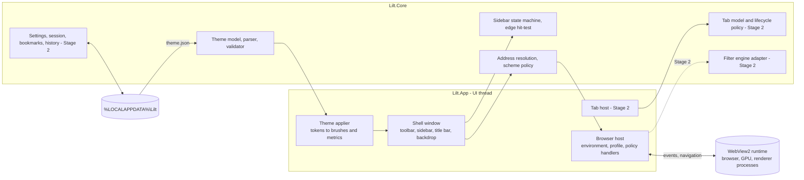
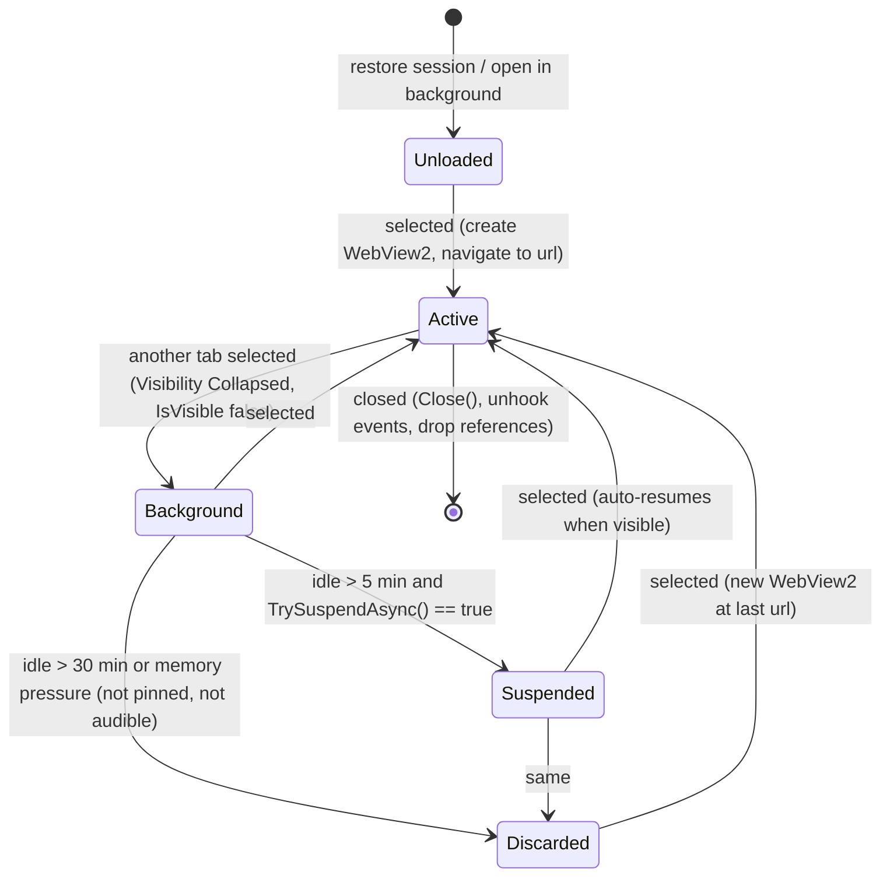

# Lilt architecture (Stage 1)

Status: draft for approval, 2026-10-14. Nothing beyond the prototype described in section 11 has been built.

Lilt is a personal Windows 11 browser built on WebView2. Its priorities, in order: customization, performance, content blocking, privacy, import convenience. This document records what the platform allows, what Lilt has to build itself, what is still unproven, and what is not possible.

Feasibility labels used throughout:

| Label | Meaning |
|---|---|
| **[API]** | Supported by a documented, stable API. |
| **[Custom]** | Lilt must implement it, on top of documented APIs. |
| **[Experimental]** | Plausible but unverified, or relies on undocumented behavior or the DevTools Protocol. Needs a spike before it is promised. |
| **[Unsupported]** | Not exposed by WebView2 or impractical for this project. |

---

## 1. Recommended stack

| Layer | Choice | Version at time of research |
|---|---|---|
| Language/runtime | C# on .NET 10 (LTS, supported to 2028-11-14) | 10.0.12 (2026-09-08) or newer patch |
| UI framework | WinUI 3 (Windows App SDK) | Windows App SDK 2.5.1 (2026-09-16); referenced via the component package `Microsoft.WindowsAppSDK.WinUI` 2.3.9 |
| Web engine | WebView2, Evergreen runtime | SDK `Microsoft.Web.WebView2` 1.0.4258.31 (2026-09-28) |
| Target | Windows 11 (build 22000+), x64, unpackaged | |
| License | GPL-3.0-or-later | |

Version notes:

- The Windows App SDK moved to semantic versioning with 2.0 (2026-04-29). The 1.8 line left servicing on 2026-09-24, so 2.x is the only supported line. Since 1.8 the main package is a metapackage that also pulls in AI, ML (ONNX Runtime, DirectML), Search and Widgets components. Lilt references only the WinUI component, which brings Foundation, InteractiveExperiences and Base transitively, to keep those binaries out of the app folder.
- From runtime 152 (2026-08-24) WebView2 ships on Edge's two-week cadence, and SDK packages are now released as needed rather than monthly. Evergreen apps need no action; the runtime patches itself.
- .NET 11 is due in November 2026 as an STS release. Staying on the LTS line is the lower-maintenance choice for now.

Why WebView2 and not a full engine:

- **Chromium via CEF (CefSharp)** is the only credible alternative on Windows. It would give in-process request filtering on the network thread (much cheaper than WebView2's cross-process event, see section 5) and full control over the engine. The costs are a ~200 MB bundled Chromium per release, a security-patch cadence Lilt would own (Chromium ships fixes every one to two weeks), and no Widevine DRM out of the box. Not worth it unless WebView2's filtering overhead proves unacceptable and the extension route in section 5 also fails.
- **Gecko** has no maintained Windows embedding API (GeckoView is Android-only). Not viable.

## 2. WebView2: what Lilt gets and what it doesn't

Embedding WebView2 is not the same as controlling a browser engine. These are the limits that shape the design:

| Capability | Status | Notes |
|---|---|---|
| Rendering, navigation, back/forward, reload per view | [API] | |
| One shared environment and profile across all tabs | [API] | One `CoreWebView2Environment` plus one user data folder means one browser process, one GPU process, and renderers per site. |
| Multiple profiles (containers, InPrivate) in one environment | [API] | `CoreWebView2ControllerOptions.ProfileName`, `IsInPrivateModeEnabled`. |
| Suspend a hidden tab | [API] | `TrySuspendAsync` requires `IsVisible == false`, is best effort, and returns false in cases like audio playback ([docs](https://learn.microsoft.com/en-us/dotnet/api/microsoft.web.webview2.core.corewebview2.trysuspendasync)). |
| Lower memory of an inactive tab that must keep running | [API] | `MemoryUsageTargetLevel = Low`. Not to be mixed with suspend ([docs](https://learn.microsoft.com/en-us/dotnet/api/microsoft.web.webview2.core.corewebview2.memoryusagetargetlevel)). |
| Per-process attribution for measurements | [API] | `CoreWebView2Environment.GetProcessInfos()` lists the processes belonging to Lilt's environment. |
| Tracking prevention level (Basic, Balanced, Strict) | [API] | `CoreWebView2Profile.PreferredTrackingPreventionLevel`; persisted per profile. Some Microsoft docs still say "always Balanced"; the profile API supersedes that. |
| SmartScreen on/off | [API] | `IsReputationCheckingRequired`. If left on, users must be told that URLs are sent to Microsoft ([data privacy](https://learn.microsoft.com/microsoft-edge/webview2/concepts/data-privacy)). |
| Keeping crash dumps local | [API] | `IsCustomCrashReportingEnabled = true` stops Windows sending WebView2 crash data to Microsoft. |
| WebView2's own required diagnostic data | [Unsupported] to disable | Collected regardless of app settings; optional data follows the Windows diagnostic data switch. Lilt itself sends nothing, but cannot claim the engine sends nothing. |
| Network request blocking | [API], cost unmeasured | `WebResourceRequested` with filters. Every matched request crosses from the browser process to Lilt's UI thread and back. |
| Cancelling a request with `ERR_BLOCKED_BY_CLIENT` | [Unsupported] | WebView2 can only substitute a response (for example an empty 204). Pages see a successful or failed fetch, not a client block. |
| Modifying response bodies in flight (HTML filtering, `##^`) | [Unsupported] | Only full response substitution, which would mean Lilt fetching pages itself. Not doing that. |
| Script and CSS injection into pages | [API] | `AddScriptToExecuteOnDocumentCreated`, `ExecuteScriptAsync`. These run in the page's main world, where page scripts can observe them. |
| Isolated script worlds | [Experimental] | Only through the DevTools Protocol (`Page.addScriptToEvaluateOnNewDocument` with `worldName`). Not covered by WebView2's stability guarantees. |
| Loading unpacked extensions | [API], capability [Experimental] | `AreBrowserExtensionsEnabled` + `AddBrowserExtensionAsync`. No toolbar, popup, badge or `action.onClicked`; no store installs. One September 2026 report has uBlock Origin Lite blocking a tracker inside WebView2 ([report](https://github.com/Lukas-Bohez/ConvertTheSpireFlutter/issues/10)). |
| Chrome Web Store extensions | [Unsupported] | Not promised. |
| Reading a tab's back/forward list | [Experimental] | Only via DevTools Protocol `Page.getNavigationHistory`. |
| Restoring a back/forward list into a new view | [Unsupported] | I found no API for it. A discarded or restored tab reopens at its last URL with a fresh history stack. |
| Moving a live page between windows without reload | [Experimental] | The controller has a settable `ParentWindow`, but WinUI's `WebView2` element only re-parents from its initial temporary window. Needs a spike; the fallback is reopening the URL. |
| Edge features: favorites, history UI, sync, collections, read aloud, translate | [Unsupported] | Turned off in WebView2 ([feature list](https://learn.microsoft.com/en-gb/microsoft-edge/webview2/concepts/browser-features)). Lilt builds what it needs. |
| Push notifications, Web Payments, periodic background sync | [Unsupported] | Not implemented in WebView2. |
| Google account sign-in | **Risk** | Microsoft's docs state Google blocks sign-in in embedded webviews, including WebView2. If that holds for gmail.com and youtube.com, it may be a deal-breaker. First thing to test (section 9). |
| Page content blended with the desktop (frosted pages) | [Unsupported] | Mica/Acrylic apply to Lilt's chrome only. `DefaultBackgroundColor` accepts only opaque or fully transparent colors. Pages stay opaque and readable. |

## 3. UI framework: WinUI 3 vs WPF

WinUI 3 is the recommendation. The deciding factor is how each framework hosts WebView2, not looks.

| Criterion | WinUI 3 | WPF | Edge |
|---|---|---|---|
| WebView2 hosting | Composition ("visual") hosting. WinUI's `WebView2` creates a `CoreWebView2CompositionController`, links its visual into the XAML tree and forwards pointer input from XAML routed events (verified in WinUI's [source](https://github.com/microsoft/microsoft-ui-xaml/tree/main/controls/dev/WebView2)). XAML can draw on top of the page and receives input first. | Standard control is an `HwndHost`: the page always draws on top of WPF content ("airspace"). The `WebView2CompositionControl` fixes airspace by screen-capturing frames into an `Image`, with lower frame rates and no DRM video ([spec](https://github.com/MicrosoftEdge/WebView2Feedback/blob/main/specs/WPF_WebView2CompositionControl.md)). | **WinUI 3.** Overlay sidebars, auto-hide reveal, command palettes and toasts over the page all depend on this. |
| Edge-triggered reveal | Pointer moves over the page arrive as XAML `PointerMoved` events marked handled; an ancestor can still observe them with `AddHandler(..., handledEventsToo: true)`. No hooks, no polling. | The page HWND swallows mouse input; reveal needs a Win32 hook or polling. | WinUI 3 |
| Backdrops | `MicaBackdrop`, `DesktopAcrylicBackdrop`, and (2.0+) `SystemBackdropElement` for backdrop anywhere in the layout. `IsSupported()` checks for fallback. | .NET 9+ Fluent theme handles Mica through DWM attributes; less control, partly experimental in code. | WinUI 3 |
| Tab strip, tear-out | `TabView` with tear-out (`CanTearOutTabs`, since 1.6); creates the new window during the drag. | No built-in tab control with tear-out. | WinUI 3 |
| Startup and idle cost | Heavier per-call cost (WinRT interop). Microsoft announced 25% faster WinUI paths in File Explorer in May 2026, with some optimizations opt-in. One informal test still ranked WinUI ahead of WPF on cold start. | Mature and lean in steady state; cold start slower in that same test. | No clear winner. Lilt's footprint is dominated by WebView2 processes; measured, not assumed (section 8). |
| Docking, layouts, keyboard | Grid-based docking is simple in both; `KeyboardAccelerator` and access keys. | Same. | Even |
| Accessibility, DPI, multi-window | UIA, per-monitor DPI v2, multiple windows per thread. WebView2's UIA provider is forwarded. | UIA, per-monitor DPI. | Even |
| Keyboard shortcuts while the page has focus | Accelerators do not reach XAML when focus is inside WebView2, and `AllowHostInputProcessing` does not apply to composition hosting. Needs a workaround (section 4.5). | `AllowHostInputProcessing` lets WPF see keys first. | **WPF** |
| Packaging and licensing | Windows App SDK runtime is proprietary (Microsoft Software License Terms); self-contained adds tens of MB. Framework-dependent mode needs the Windows App Runtime installed. | Ships with the .NET Desktop runtime, MIT licensed. | WPF |
| Maintenance | Faster-moving, more breaking changes (now gated to major versions). Build tooling is Windows-only. | Stable, slower-moving. Build tooling also Windows-only in practice. | WPF |

WPF wins on keyboard routing, licensing and stability. WinUI 3 wins on the things the product is about: overlaid, flexible chrome over live pages, native materials, and tab tear-out. The keyboard gap has workable fixes; the airspace problem in WPF does not have a fix that keeps DRM video and full frame rate.

## 4. Application architecture

### 4.1 Projects

```
src/Lilt.Core   net10.0, no Windows or UI dependencies. Themes, layout state, URL policy; later tabs model, filtering engine adapter, persistence, import parsers.
src/Lilt.App    net10.0-windows, WinUI 3. Window, shell, WebView2 hosting, Windows-only services (DPAPI, file pickers).
tests/Lilt.Core.Tests   Dependency-free console test runner for Lilt.Core (runs on any OS).
tools/measure.ps1       External measurement script (process-tree memory and CPU).
```

Keeping the core free of WinUI means the theme parser, sidebar logic and URL policy are tested on any machine, and the boundary stops UI code from leaking into persistence or filtering.

### 4.2 Components and boundaries



Rules:

- The browser UI is native XAML, never HTML in a WebView. Web content cannot restyle, script or spoof the chrome, and content-filter rules can't touch it.
- Only `BrowserHost` (and later `TabHost`) touch WebView2 objects. Shell code asks for navigations; it never subscribes to engine events directly.
- `Lilt.Core` types are plain records and classes. Persistence and filtering live there behind small interfaces only where there are two real implementations.
- No host objects, no `chrome.webview` messaging in the prototype. Any future native/web channel goes through one validated entry point (origin check, schema, size limit).

### 4.3 Process, environment and profile model

- One `CoreWebView2Environment` per Lilt instance, created once at startup with a user data folder at `%LOCALAPPDATA%\Lilt\WebView2` (WebView2's default for unpackaged apps would be next to the exe).
- One profile, `Default`, for normal browsing. InPrivate windows use a second controller with `IsInPrivateModeEnabled`. Firefox-style containers map to named profiles in the same environment.
- Environment options: crash dumps kept local, browser extensions off, tracking prevention on, Fluent overlay scrollbars.
- Expected process set: Lilt, one WebView2 browser process, one GPU process, utility processes (network, storage, audio), crashpad, and one renderer per site instance (site isolation). Section 11 records the measured set.

### 4.4 Tab lifecycle (Stage 2 design)

A tab is a Core record (`id, url, title, favicon, pinned, lastActive, state`) that may or may not have a WebView2 attached.



- **Lazy creation [Custom].** Restored and background-opened tabs stay `Unloaded` until selected; only the descriptor is in memory.
- **Background [API].** Collapsing the element sets the controller's `IsVisible = false`. WinUI's source also ties `IsVisible` to `XamlRoot.IsHostVisible`, which should cover a minimized window; section 8 checks that. Rendering stops; scripts keep running. Hiding alone is not assumed to save memory.
- **Suspended [API].** Timers and animations paused, renderer memory reclaimable. Best effort; failures leave the tab in Background.
- **Discarded [Custom].** WebView2 closed. Keeps URL, title, favicon and Lilt's own history entries. The engine's back/forward stack and page state (form contents, scroll) are lost, because no API restores them. The UI marks discarded tabs.
- **Closed.** Remove event handlers, call `Close()`, release the element. Memory returned to the OS is verified by measurement, not assumed.
- **Moving a tab to another window.** Spike: move the live element (needs controller re-parenting). Fallback: open the URL in the target window, which is the Discarded path.

### 4.5 Keyboard

Shortcuts are routed through one command table (command id, default gesture, user override). Commands work when focus is in Lilt's chrome via `KeyboardAccelerator`.

When focus is inside the page, WinUI does not see keystrokes. Options, in order of preference, for the Stage 2 spike:

1. **[Experimental]** DevTools Protocol isolated world: a capture-phase `keydown` listener added with `Page.addScriptToEvaluateOnNewDocument` (`worldName`), reporting through `Runtime.addBinding` scoped to that world. Pages cannot see or forge it. Cross-site iframes need extra attachment.
2. **[API]** Main-world script plus `chrome.webview.postMessage`. Simple, but it exposes `window.chrome.webview` to every site (an easy embedded-webview fingerprint) and messages can be forged by the page, so only harmless commands could use it.
3. Browser-native keys keep working regardless: Alt+Left/Right, F5, Ctrl+F, Ctrl+P, zoom, DevTools (`AreBrowserAcceleratorKeysEnabled` stays on until Lilt owns these).

Tab and Shift+Tab already move focus between page and chrome (WinUI handles `MoveFocusRequested`).

## 5. Content filtering

### 5.1 Engine options

| Option | License | Network rules | Cosmetic | uBO extended syntax | Integration cost | Status |
|---|---|---|---|---|---|---|
| **adblock-rust** (Brave) | MPL-2.0 | EasyList/EasyPrivacy, ABP and uBO network syntax, `$redirect` | Yes (host-specific and generic, by class/id lookup) | Many extensions, scriptlets via uBO-compatible resources | Rust toolchain plus a ~200-line C ABI wrapper; P/Invoke from C# | Maintained; powers Brave; prototype engine in Firefox 149 |
| **uBlock Origin Lite inside WebView2** | GPL-3.0 | Precompiled declarativeNetRequest rulesets, matched natively by Chromium | Yes, via its own content scripts | Partial (MV3 limits) | Load unpacked; build Lilt UI for settings; per-site switches need a "current tab" WebView2 doesn't give | [Experimental]: one positive report, no UI surface |
| **WebView2 tracking prevention (Strict)** | n/a | Microsoft's tracker lists only, not ad lists | No | No | One property | [API]; always-on baseline |
| Ghostery adblocker | MPL-2.0 | Yes | Yes | Partial | TypeScript; needs a JS runtime beside Lilt | Impractical for per-request native use |
| Writing a C# filter engine | n/a | | | | Large, with endless compatibility work | Rejected |

### 5.2 Recommendation

Run a measured spike before committing, because the main unknown is cost, not features:

1. Baseline: Tracking prevention set to Strict on the default profile, with a per-site fallback to Balanced if breakage shows up.
2. **Path A (native engine).** adblock-rust compiled to a DLL, matching on `WebResourceRequested` (URI filter `*`, all resource contexts, request sources document, shared worker and service worker; top-level navigations are never blocked). Blocked requests get an empty 204 response; `$redirect` gets the resource body. Measure page-load time and UI-thread time on the URL set in section 8 with 0, 1k and 100k rules.
3. **Path B (extension).** uBlock Origin Lite loaded unpacked into the profile. No per-request round trip to Lilt. Measure the same pages, and check what settings and counts can be surfaced.

Choose A if its overhead on the 10-page set stays under roughly 5% of load time; choose B if A is too costly and B's lack of UI is acceptable. A and B are not mutually exclusive (B for blocking, A's engine for cosmetic lookups and counts), but running both doubles memory and should be justified by measurement.

### 5.3 Compatibility target (Path A)

| Syntax | Status |
|---|---|
| ABP network filters (`||`, `^`, `*`, `|`, `@@`, `$third-party`, `$domain=`, resource types, `$important`, `$badfilter`) | Supported |
| `$redirect` / `$redirect-rule` to neutered resources | Supported via response substitution |
| Hosts-file lists | Supported |
| Cosmetic `##`, `#@#`, generic and host-specific | Supported (CSS injected per document) |
| Procedural cosmetic (`:has-text`, `:upward`, `:xpath`, ...) | Partial; needs Lilt's in-page script |
| Scriptlets `##+js(...)` | Supported with uBO resources (GPL-3.0, compatible with Lilt's license) |
| `$removeparam`, `$header`, `$csp`, `$permissions` | Unsupported (cannot rewrite requests or response headers cleanly) |
| HTML filtering `##^` | Unsupported |

### 5.4 Behaviour

- Network blocks and hidden elements are counted separately. Network counts are exact for requests that passed through Lilt's handler. Tracking-prevention blocks are not visible to Lilt and are labelled as uncounted. Hidden-element counts come from an in-page script and are shown as approximate.
- Per-site enable/disable, a permanent allowlist and temporary exceptions live in Core settings.
- Lists are files under `%LOCALAPPDATA%\Lilt\filters`, with source URL, ETag and last-updated time. Updates run only when the user enables them, against the list's own URL, and are the only outbound requests Lilt itself makes. A list that fails to parse is skipped and the previous compiled copy kept; status shows "partial" when any list is missing or rules were dropped.
- Status states: off, active, partial (some lists or syntax unsupported), error.
- Injected CSS and scripts target web origins only (`http`, `https`), are added per document, and never have access to host objects.

## 6. Theme, layout and customization

### 6.1 Three layers

| Layer | Contains | Stored in |
|---|---|---|
| Theme | Colors, typography, shape, density, motion, dimensions, backdrop | `theme.json` (prototype: `%LOCALAPPDATA%\Lilt\theme.json`) |
| Layout preset | Sidebar edge, mode (pinned/auto-hide), visible panels, tab placement | Prototype: the theme's `sidebar` block. Stage 2: `layouts/*.json` with the same shape, so presets can be saved and switched without touching colors. |
| Settings | Behavior: search engine, privacy toggles, shortcuts | Stage 2: `settings.json` |

### 6.2 Theme file

Readable, versioned JSON with comments and trailing commas allowed. Colors use CSS order (`#RRGGBB` or `#RRGGBBAA`). A JSON Schema (`theme.schema.json`) ships next to the file for editor autocompletion; the C# validator is authoritative and a test keeps the two in sync.

```jsonc
{
  "$schema": "./theme.schema.json",
  "schemaVersion": 1,
  "name": "Dusk",
  "base": "dark",            // light | dark
  "backdrop": "mica",        // mica | micaAlt | acrylic | none
  "colors": { "background": "#141318", "surface": "#1D1B23B3", "accent": "#C4A7FF", ... },
  "typography": { "family": "Segoe UI Variable Text", "size": 13, "weight": 400 },
  "shape": { "radius": 8, "controlRadius": 6, "borderWidth": 1 },
  "density": "standard",     // compact | standard | comfortable
  "toolbar": { "height": 44 },
  "sidebar": { "edge": "left", "width": 248, "height": 48, "autoHide": false, "revealEdge": 6, "hideDelay": 350 },
  "motion": { "animations": true, "duration": 160 }
}
```

Validation and recovery:

| Problem | Result |
|---|---|
| File missing | Default theme written to that path, then loaded. If it can't be written, built-in defaults are used. |
| JSON syntax error | At startup: built-in defaults. On live reload: last good theme kept. Either way a notice shows the line and position. |
| Invalid value (bad color, out of range) | That value falls back to its default; a warning names the path, e.g. `colors.accent`. |
| Unknown key | Ignored with a warning (catches typos). |
| Newer `schemaVersion` | Known fields load; warning. |
| File over 1 MB | Rejected as invalid. |

Tokens flow one way: file → Core `Theme` → `ThemeApplier` → (a) shared brushes mutated in place so every bound element updates, (b) metrics on the shell elements, (c) caption button colors, (d) backdrop, (e) WebView2 default background color. Nothing in XAML hard-codes a color.

Live reload uses `FileSystemWatcher` on the theme's folder with a 200 ms debounce, so editors that save in several writes or by rename cause one reload. No polling.

Accessibility: Windows high contrast overrides theme colors and disables the backdrop. Animations run only if both the theme and the Windows "Animation effects" setting allow them. Font size has a floor of 9 and the validator rejects colors only by format, not contrast; a contrast warning is a Stage 2 item.

Planned, not in schema v1: tab dimensions and states, toolbar item visibility, per-panel styles. They are added as new optional blocks, so v1 files stay valid.

### 6.3 Sidebar

Modes:

- **Pinned:** docked at an edge, takes layout space, page reflows once.
- **Auto-hide:** hidden; slides over the page (overlay) when revealed, so the page does not reflow on every reveal.

Placement: left, right, top or bottom. Left/right use `width`; top/bottom use `height`, and the panel's content flows horizontally.

Reveal and hide rules (Core `SidebarState`, unit-tested):

| Event | Effect |
|---|---|
| Pointer within `revealEdge` px of the sidebar's edge of the content area, no mouse button pressed | Reveal |
| Pointer enters sidebar | Cancel pending hide |
| Pointer leaves sidebar | Hide after `hideDelay` ms, unless keyboard focus is inside it |
| Keyboard toggle (Ctrl+B) or toolbar button | Reveal and focus the sidebar, or hide |
| Escape inside sidebar, or click on the page | Hide now |
| Focus leaves sidebar while pointer is outside | Hide after delay |

How the edge is detected: the root content grid registers a `PointerMoved` handler with `handledEventsToo: true`. WinUI's `WebView2` receives pointer input as XAML events (it marks them handled and forwards them to the engine), so the root still sees every move over the page. This is event-driven: no timers, no global hooks, no cursor polling. The one timer is the hide delay, a single-shot debounce restarted on re-entry.

Known interaction risks and mitigations:

- A right-docked auto-hide sidebar competes with the page scrollbar. Lilt uses Fluent overlay scrollbars, ignores the edge while a button is held (dragging a scrollbar or selecting text), and keeps `revealEdge` small (default 6 px, configurable).
- On a maximized window the edge is the screen edge, which is easy to hit. On a floating window it is a thin target; the toolbar toggle and Ctrl+B are the reliable paths.
- A top auto-hide sidebar reveals from the top of the content area, below the toolbar, because the toolbar row is the title bar.

Not planned: a general docking framework with floating panels. Presets cover the real need.

## 7. Security and privacy

### 7.1 Threat model

| Threat | Vectors | Mitigations | Residual risk |
|---|---|---|---|
| Malicious website | Exploits, phishing, permission abuse, external app launches, popups, fullscreen spoofing | Chromium sandbox and site isolation (runtime); no host objects or web messaging; permission requests denied by default with a notice; `mailto:` and other external schemes blocked until a prompt exists; popups open in the same view (prototype) or a new tab (Stage 2); fullscreen shows an exit hint (Stage 2) | Runtime zero-days, patched by Microsoft's Evergreen updates |
| Compromised renderer | Escape attempts to the browser process, then to Lilt | Lilt exposes no IPC surface to pages; any future channel validates origin, message shape and size | Same as Edge |
| Malicious download | Executables, documents with macros | WebView2 download pipeline, SmartScreen reputation (if kept on); no auto-open; Mark-of-the-Web behaviour to be verified in Stage 2 | User choice to run a file |
| Malicious import file | Oversized or crafted HTML/CSV/JSON; `javascript:` bookmarks | Size limits, streaming parsers, titles treated as text, only `http/https` URLs imported (others listed for review), parse errors reported without echoing contents | Low |
| Malicious theme file | Unreadable colors, huge files | 1 MB cap, schema validation, no URLs or images in schema v1 | Cosmetic only |
| Local profile exposure | Another process or person reading `%LOCALAPPDATA%\Lilt` | Per-user ACLs; Lilt-owned secrets protected with DPAPI (current user); Chromium normally encrypts cookies and saved passwords with a DPAPI-protected key (to be confirmed for WebView2 profiles) | Caches and history are readable by anything running as the user. Lilt will not claim the profile is encrypted at rest. |
| Unintended outbound traffic | Lilt itself, the runtime | Lilt: none by default; filter-list updates only when enabled, to documented URLs. Runtime: see 7.3 | WebView2's required diagnostic data |
| Address bar abuse | `javascript:`, `file:`, `data:` typed or pasted | Address input resolves only `http`, `https` and `about:blank`; other schemes are refused with a message | None known |

### 7.2 Defaults

- HTTPS preferred: typed hosts become `https://`; loopback and IP literals use `http://`. Stage 2 adds HTTPS-first for clicked `http://` links: try HTTPS, and on failure show an interstitial with a "continue over HTTP" option remembered per host for the session. WebView2 has no documented HTTPS-only switch, so this is [Custom].
- Permissions: deny by default; Stage 2 adds a prompt bar and per-site decisions via `SetPermissionStateAsync`.
- Password autosave: off (WebView2 default). General autofill: on (default).
- DevTools: on (it's a browser).
- Renderer crash: notice with a Reload action. Browser process exit: notice with a "Restart engine" action that recreates the environment.

### 7.3 Outbound traffic to disclose

| Source | Traffic | Control |
|---|---|---|
| Lilt | None in the prototype. Later: filter list updates, update checks | Opt-in, documented hosts |
| WebView2 required diagnostic data | Sent to Microsoft | Cannot be disabled by Lilt |
| WebView2 optional diagnostic data | Sent if Windows optional diagnostic data is on | Windows setting |
| SmartScreen | URL and download reputation checks to Microsoft | `IsReputationCheckingRequired`; also the Windows "SmartScreen for Microsoft Edge" setting. Prototype: on (question 1) |
| Crash dumps | Not sent | `IsCustomCrashReportingEnabled = true` |
| Tracking prevention lists, runtime updates | Downloaded by the runtime and Edge Update | Microsoft-managed |

Stage 2 includes a traffic audit on a real machine (Windows Firewall logging or a proxy) to confirm this table rather than rely on documentation.

### 7.4 Updates (future release)

Not built in the prototype. Options when Lilt is distributed:

- Signed MSIX plus an App Installer file. Windows verifies the package signature before install. Needs a code-signing certificate (Azure Trusted Signing is the cheapest trusted option).
- Unpackaged installer with an updater that verifies a detached signature (Ed25519) over a manifest containing SHA-256 hashes, and the Authenticode signature of the installer, before running anything. Fails closed.
- winget manifest for manual updates (`winget upgrade`), which pins SHA-256 hashes.

Either way: HTTPS only, no silent execution of unverified content, and rollback to the previous version on failed verification.

## 8. Performance plan

Principles: one environment and profile, no WebView2 until it shows content, no polling timers in the shell, no blur effects beyond the system backdrop, work deferred until after the first frame, and measurements before claims.

### 8.1 Method

Measured with `tools/measure.ps1`, which launches a browser with a fresh temporary profile, waits for a settle period, then reads the whole process tree (the browser and every descendant) through `Win32_Process`:

- Working set and private bytes, reported separately, summed over the tree and broken down by process type.
- Average CPU over a fixed interval: change in user plus kernel time divided by wall time, as a share of one logical core.
- Startup: Lilt writes timestamps (process start to window activated, WebView2 ready, first navigation completed) when run with `--startup-report`.

Conditions recorded per run: machine, Windows build, power plan, browser and runtime versions, window state, settle and sample durations, whether pages finished loading. Five runs per scenario; median, min and max reported.

### 8.2 Scenarios

| # | Scenario | Needs |
|---|---|---|
| 1 | Idle, empty view (`about:blank`), window visible | Prototype |
| 2 | Ten tabs, URL set below, all loaded, then 60 s idle | Tabs |
| 3 | Thirty tabs (URL set three times) | Tabs |
| 4 | Window minimized for 5 minutes | Prototype (idle page); tabs for the full version |
| 5 | Page load with blocking on and off (the three ad-heavy pages below) | Filtering |

URL set: `en.wikipedia.org/wiki/Web_browser`, `bbc.com/news`, `github.com/microsoft/microsoft-ui-xaml`, `reddit.com/r/Windows11`, `youtube.com`, `news.ycombinator.com`, `learn.microsoft.com/microsoft-edge/webview2`, `theverge.com`, `amazon.com`, `nytimes.com`. Live pages change, so results carry dates; a local mirror can be added if variance is too high.

Comparisons: Edge, Firefox and Helium (0.14.x, Windows builds exist) with fresh profiles in the same session, where they are installed. Edge needs startup boost and background mode off to give a clean process tree. Results that can't be reproduced are not reported.

### 8.3 Questions measurement must answer

1. Does `Visibility.Collapsed` on a WebView2 reduce CPU and memory, or only rendering?
2. How much does `TrySuspendAsync` reclaim per tab, and how often does it fail?
3. What does closing a tab return to the OS?
4. What does `WebResourceRequested` with `*` cost per page load, on the UI thread and in wall time?
5. Self-contained Windows App SDK vs framework-dependent: startup and disk.
6. ReadyToRun and Native AOT: startup and working set of the Lilt process.

## 9. Roadmap

Ordered by value and risk. Each stage ends with measurements and a short report.

1. **Risk spikes (small, first).**
   1. Google sign-in (Gmail, YouTube) and a handful of daily sites inside Lilt. If Google blocks it, decide before anything else.
   2. Keyboard shortcuts with focus in the page (isolated-world approach, section 4.5).
   3. Filtering cost: Path A vs Path B on the URL set.
   4. WebView2 lifecycle: hidden vs suspended vs closed, with 1, 10 and 30 views.
2. **Tabs v1.** Tab model in Core, tab strip (placement per question 4), lazy creation, background and suspend policy, close and memory recovery, URL-level session restore, keyboard switching.
3. **Content blocking v1.** Chosen engine, counts, per-site toggle, allowlist, list updates with timestamps, status indicator.
4. **Customization v1.** Settings file, layout presets, configurable shortcuts, command palette, theme picker with live preview, contrast warnings.
5. **Security hardening.** HTTPS-first with interstitial, permission prompts, downloads panel, fullscreen hint, external-scheme prompt, traffic audit.
6. **Import.** Bookmarks HTML, history (format below), passwords after a separate review.
7. **Windows.** Multiple windows, tab tear-out, drag between windows.
8. **Packaging and updates.** Signed builds, updater per 7.4, startup work (ReadyToRun, AOT).

### 9.1 Chrome import plan

All local, all user-initiated, no reading of Chrome's profile by default, no cookies.

| Data | Format | Handling |
|---|---|---|
| Bookmarks | Netscape bookmark HTML (Chrome: Bookmark manager, Export) | Streaming parse of `<DT><A HREF>` and folders; titles as text; `http/https` only; others listed for review |
| History | Google Takeout `Chrome/History.json`: `Browser History` array of `{title, url, time_usec, ...}` ([schema](https://developers.google.com/data-portability/schema-reference/chrome)). Chrome has no local history export. | JSON stream parse; dedupe by URL and time; imported into Lilt's history store. Reading Chrome's `History` SQLite file directly would need its own security review and a read-only copy. |
| Passwords | Chrome password export CSV (header-driven: `url`, `username`, `password`; `name` and `note` optional) | Explicit action with a plaintext-risk warning; read into memory only, no temp files, no logging of rows; stored via DPAPI; the user is reminded to delete the CSV (no secure-erase claim). Not built until question 2 is answered. |

Decrypting Chrome's stored data or extracting its keys is out of scope.

## 10. Dependencies and licensing

Lilt is GPL-3.0-or-later. Prototype dependencies:

| Dependency | Why | License | Removable? |
|---|---|---|---|
| `Microsoft.WindowsAppSDK.WinUI` 2.3.9 (+ transitive Base, Foundation, InteractiveExperiences, Windows SDK build tools) | WinUI 3 | Microsoft Software License Terms (proprietary, redistributable) | Only by switching to WPF |
| `Microsoft.Web.WebView2` 1.0.4258.31 | WebView2 SDK (newer than WinUI's minimum 1.0.3719.77) | BSD-3-Clause-style | No |
| .NET 10 (`System.Text.Json` etc.) | Runtime | MIT | No |

No other packages. The JSON Schema is a static file; validation is hand-written to avoid a schema library.

Licensing notes (engineering assessment, not legal advice):

- Lilt's GPL code links against the proprietary Windows App SDK. The GPL's system-library exception may not clearly cover a redistributed SDK, and the SDK's terms forbid distributing it under a license that requires source disclosure. Recommended before any public release: (a) ship framework-dependent, so users get the Windows App Runtime from Microsoft and Lilt does not redistribute it, and (b) add a GPLv3 section 7 additional permission allowing linking with the Windows App SDK and WebView2. Personal, undistributed builds are unaffected.
- adblock-rust (MPL-2.0) is GPL-compatible. uBlock Origin resources and uBO Lite are GPL-3.0, compatible with Lilt. EasyList and EasyPrivacy are dual-licensed GPL-3.0 / CC BY-SA 3.0.

## 11. Prototype (built in this stage)

Scope, matching the brief:

- Native window with Mica (theme can choose Mica Alt, Acrylic or none), solid fallback when unsupported or in high contrast.
- Custom title bar: the toolbar row is the drag region; controls in it are click-through regions; caption buttons follow the theme.
- One WebView2 view with back, forward, reload/stop and an address field (URL or search), a "Not secure" marker for HTTP pages.
- Sidebar docking to all four edges, pinned or auto-hide with edge reveal and debounced hide, keyboard toggle (Ctrl+B), Escape to dismiss.
- Theme loaded at startup from `%LOCALAPPDATA%\Lilt\theme.json`, validated with fallbacks, live-reloaded on save. A light theme sample ships too.
- Security defaults from 7.2, permission and external-scheme blocking with notices, crash notices.
- On-demand memory readout in the sidebar (no background sampling).

Command-line options: `--url <url>`, `--theme <path>`, `--user-data <dir>`, `--startup-report <file>`.

Not in the prototype: tabs, filtering, settings, import, multiple windows, page-focus shortcuts. See `docs/prototype-report.md` for build steps, measurements and limitations.

## 12. Questions for you

1. **SmartScreen.** Keep it on (malicious-site and download warnings; visited URLs are checked with Microsoft) or turn it off for privacy? The prototype keeps it on.
2. **Passwords.** Build Lilt's own encrypted vault with CSV import and click-to-fill (large, security-sensitive), or rely on WebView2's built-in password saving (no import; passwords get saved again as you sign in)?
3. **Rust in the build.** If adblock-rust wins the filtering spike, is adding a Rust toolchain to the build acceptable? (Otherwise Path B or nothing.)
4. **Tabs.** Vertical tabs in the sidebar (the sidebar becomes the tab list, and auto-hide hides tabs) or a horizontal tab strip in the toolbar? Both will be possible eventually; this sets the default and the order of work.
5. **Public release.** Is a public release likely in the next few months? If so I'll plan framework-dependent packaging and the GPL linking permission from the start.

## Sources

- Windows App SDK [release channels](https://learn.microsoft.com/en-us/windows/apps/windows-app-sdk/release-channels), [downloads](https://learn.microsoft.com/en-us/windows/apps/windows-app-sdk/downloads), [2.0 release notes](https://learn.microsoft.com/en-us/windows/apps/windows-app-sdk/release-notes/windows-app-sdk-2-0?pivots=stable), [1.8 release notes](https://learn.microsoft.com/en-us/windows/apps/windows-app-sdk/release-notes/windows-app-sdk-1-8), [1.6 announcement](https://blogs.windows.com/windowsdeveloper/2024/09/04/whats-new-in-windows-app-sdk-1-6/)
- NuGet: [Microsoft.WindowsAppSDK](https://www.nuget.org/packages/Microsoft.WindowsAppSDK), [Microsoft.WindowsAppSDK.WinUI](https://www.nuget.org/packages/Microsoft.WindowsAppSDK.WinUI), [Microsoft.Web.WebView2](https://www.nuget.org/packages/microsoft.web.webview2)
- [.NET 10 releases](https://github.com/dotnet/core/blob/main/release-notes/10.0/README.md)
- [WebView2 release cadence change](https://github.com/MicrosoftEdge/WebView2Announcements/issues/137)
- WebView2: [performance](https://learn.microsoft.com/microsoft-edge/webview2/concepts/performance), [hosting modes](https://learn.microsoft.com/en-nz/Microsoft-edge/webview2/concepts/windowed-vs-visual-hosting), [threading](https://learn.microsoft.com/cs-cz/microsoft-edge/webview2/concepts/threading-model), [WebResourceRequested](https://learn.microsoft.com/en-us/microsoft-edge/webview2/how-to/webresourcerequested), [filter remarks](https://learn.microsoft.com/en-us/dotnet/api/microsoft.web.webview2.core.corewebview2.addwebresourcerequestedfilter?view=webview2-dotnet-1.0.4258.31), [environment options](https://learn.microsoft.com/en-us/microsoft-edge/webview2/reference/winrt/microsoft_web_webview2_core/corewebview2environmentoptions), [controller options](https://learn.microsoft.com/en-us/microsoft-edge/webview2/reference/winrt/microsoft_web_webview2_core/corewebview2controlleroptions), [profile](https://learn.microsoft.com/ru-ru/microsoft-edge/webview2/reference/winrt/microsoft_web_webview2_core/corewebview2profile), [extensions spec](https://github.com/MicrosoftEdge/WebView2Feedback/blob/main/specs/Extensions.md), [Edge features in WebView2](https://learn.microsoft.com/en-gb/microsoft-edge/webview2/concepts/browser-features), [data privacy](https://learn.microsoft.com/he-il/microsoft-edge/webview2/concepts/data-privacy), [SmartScreen setting](https://learn.microsoft.com/en-us/dotnet/api/microsoft.web.webview2.core.corewebview2settings.isreputationcheckingrequired)
- WPF: [WebView2 in WPF](https://learn.microsoft.com/da-dk/microsoft-edge/webview2/platforms/wpf), [WebView2CompositionControl spec](https://github.com/MicrosoftEdge/WebView2Feedback/blob/main/specs/WPF_WebView2CompositionControl.md), [.NET 9 WPF](https://learn.microsoft.com/dotnet/desktop/wpf/whats-new/net90)
- WinUI: [WebView2 control source](https://github.com/microsoft/microsoft-ui-xaml/tree/main/controls/dev/WebView2), [composition controller discussion](https://github.com/MicrosoftEdge/WebView2Feedback/issues/3439), [WinUI performance work, May 2026](https://www.devclass.com/development/2026/05/14/microsoft-aims-to-speed-windows-with-leap-forward-in-winui-3-perf/5239721), [startup comparison](https://www.mrlacey.com/2025/07/how-much-does-start-up-time-matter-when.html)
- Keyboard: [WinForms/WebView2 keyboard issue](https://github.com/MicrosoftEdge/WebView2Feedback/issues/1703), [AllowHostInputProcessing](https://weblog.west-wind.com/posts/2025/Aug/20/Using-the-new-WebView2-AllowHostInputProcessing-Keyboard-Mapping-Feature)
- Filtering: [adblock-rust README](https://app.unpkg.com/adblock-rs@0.13.2/files/README.md), [adblock-rust in Firefox 149](https://www.gigazine.net/gsc_news/en/20260427-adblock-rust-on-firefox), [uBO Lite in WebView2 report](https://github.com/Lukas-Bohez/ConvertTheSpireFlutter/issues/10)
- Licensing: [Windows App SDK license](https://www.nuget.org/packages/Microsoft.WindowsAppSDK.WinUI/2.3.9/license), [WebView2 SDK license](https://www.nuget.org/packages/Microsoft.Web.WebView2/1.0.4258.31/license)
- Import: [Chrome data portability schema](https://developers.google.com/data-portability/schema-reference/chrome), [Chrome password import/export](https://support.google.com/chrome/answer/13068232?hl=en)
- Comparison: [Helium for Windows releases](https://github.com/imputnet/helium-windows/releases)
